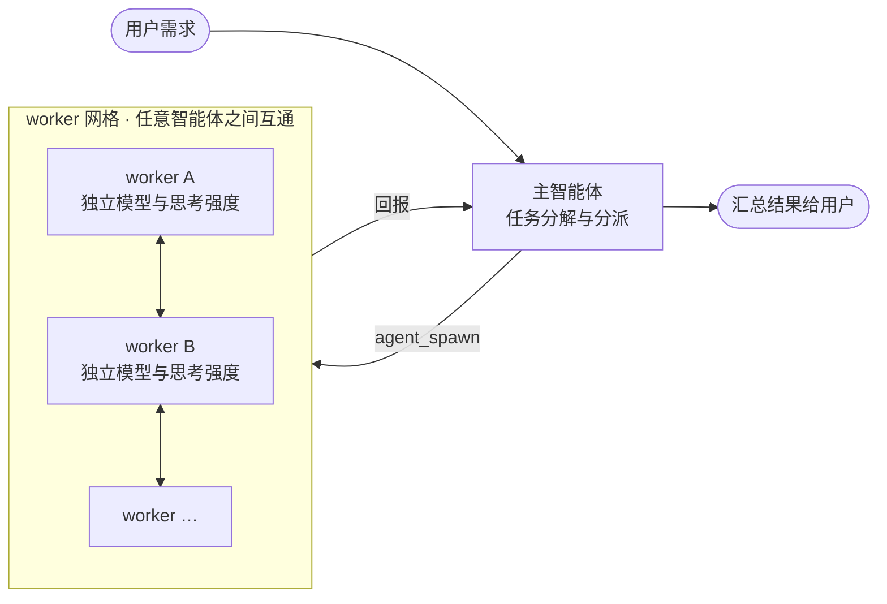

# dsh-orchestrator

> **orchestrator** 意为「编排器 / 协调者」；读音：美 /ˈɔːrkəstreɪtər/ · 英 /ˈɔːkɪstreɪtə(r)/，重音在第三音节，近似「奥克斯**特雷**特尔」。

面向 [DeepSeek Harness](https://github.com/deepseek-ai/deepseek-harness) 的原生全互联智能体编排插件：
一个主智能体负责任务分解与分派，多个 worker 负责实际执行，**任意智能体之间都能原生互发消息**
（主 → 子、子 → 主、子 ↔ 子），并支持为每个 worker 单独指定模型与思考强度。
没有文件信箱、没有提示词约定、没有轮询——消息直接走 harness 自带的智能体收件箱，
并以 harness 的 coordinator relay 归因持久化到轨迹。



## 功能总览

### 网格通信与运行控制

- **派生**：`agent_spawn` 创建常驻后台、可持续对话的 worker；可按 worker 指定
  `provider` / `model` / `maxTokens` / `effort`，或用 harness **worker 模板**一键派生。
  spawn 时对显式指定的路由做**严格校验**——拼错立即报错并列出该 provider 的可用模型，绝不静默降级。
- **消息**：`agent_send` 给网格内任意智能体发消息（排队为目标的*下一回合*）；
  `agent_broadcast` 一条消息广播到所有在线成员。
- **插话**：`agent_send` 带 `steer: true` 时，运行中的目标在其**最近的步骤边界**（模型步骤之间，
  不打断进行中的工具调用）消费消息——典型用法是「先汇报当前进度，再继续执行」；空闲目标立即开新回合。
- **停止**：`agent_interrupt` 取消某个在线智能体的**当前回合**（中途停下跑偏的任务），
  排队中的消息保留不丢；取消原因持久记录在目标轨迹。停下后接一条 `agent_send` 即可改道。
- **收尾纪律内置**：worker 提示词自动附带「大产物写文件、汇报只发指针」「最终汇报保持精炼」等约定。

### Continual Harness（可自我改进的持久状态）

- 三类条目：**memory**（网格教训）、**worker**（可复用派生模板）、**prompt**（提示注记）。
- **证据约束**：每次修改必须带 `summary` + `rationale`（出自真实轨迹证据）；乐观并发
  （`base_version` 不匹配即拒绝）；保留 id 黑名单——基座提示词不可被自我改写。
- **审计与回滚**：每条 edit 存 before/after 快照、append-only 修改历史；`rollback`
  逆向重放为一个带 `rollbackOf` 标记的新记录（回滚本身也进审计链）。
- **双作用域**：默认 **session-local**（经会话日志持久，随会话恢复）；显式 **global**
  （跨会话 JSON 存储 + 审计文件）。
- **渐进披露**：系统提示只注入每类至多 6 条 × 180 字符的概览（`{{mesh_harness}}` 变量），
  完整条目按需用 `agent_harness list` 读取。

### 定时唤醒

- `agent_schedule` 给自己或任意成员安排一次性（`delay_ms` / `at_ms`）或重复（`every_ms`）唤醒消息；
  链式投递——错过的 tick 合并不堆积、目标离线跳过并续排。进程内实现，重启即失
  （跨重启的持久调度属宿主能力，见[上游建议](docs/agents/host-upstream-recommendations.md)）。

### 可观测性与持久恢复

- `agent_list`：网格花名册——标签、父级、spawn 时路由、主智能体标记，以及**每个成员的
  token 用量**（`inputTokens` / `outputTokens`）；已结束 worker 以 `settled` 状态保留在册。
- `agent_trace`：只读穿透任意成员的轨迹（轮次、消息、工具调用与结果），在线读内存快照、
  已结束 worker 读持久化日志；读取永不唤醒目标。
- **冷复活**：向你自己派生的已结束 worker 发送 `agent_send` 会从持久化会话恢复并继续对话。
- **跨重启恢复**：花名册、标签、路由与思考强度从持久化日志自动恢复，宿主重启后依然有效。

## 一键安装

把下面这句话发给你的 DSH 智能体，它会全自动完成安装：

> 请自动安装 dsh-orchestrator 插件：运行 `ls $DSH_HOME/profiles` 找到我的 profile 名，然后执行
> `dsh plugin --profile <该名字> add dsh-orchestrator`；若失败，加 `--registry=https://registry.npmjs.org`
> 重试一次；完成后提醒我重启 dsh。

装完**重启 `dsh`** 生效（运行中的进程不会热加载新安装的包）。

## 手动安装

| 方式 | 命令 |
| --- | --- |
| npm（推荐） | `dsh plugin --profile <name> add dsh-orchestrator` |
| GitHub 源码 | `dsh plugin --profile <name> add github:zibo2025/dsh-orchestrator#v0.3.0` |

- `<name>` 是你的 profile 名，即 `$DSH_HOME/profiles/` 下的目录名（例如 `web`）。
- 国内镜像未同步时用官方源：`dsh plugin --profile <name> add dsh-orchestrator --registry=https://registry.npmjs.org`。
- GitHub 方式需 pnpm ≥ 10 一次性 `allowBuilds` 授权：第一次 `add` 失败后，把它打印的包键加进
  profile 的 `pnpm-workspace.yaml` 的 `allowBuilds`，再重跑命令。

生效范围两种：**组合包**（该 profile 的所有会话都获得网格工具）或**仅预设**（在预设的
`agent.cordis.yml` 加一行 `- id: orchestrator` + `name: dsh-orchestrator`，并 `pnpm add dsh-orchestrator`，
推荐——协议只在你需要的地方生效）。

## 工具

| 工具 | 作用 |
| --- | --- |
| `agent_spawn` | 派生一个常驻后台、可持续对话的 worker；可单独指定 `provider` / `model` / `maxTokens` / `effort`；`template` 参数按 harness worker 模板派生（显式参数优先于模板）；显式路由严格校验，失败报错并列可用模型 |
| `agent_send` | 给网格内任意智能体发消息（子 → 主、子 ↔ 子都行），不返回对方的答复；对**你自己派生的**已结束 worker 冷复活后继续投递；`steer: true` 改为插话（见上）；返回 `mode` 标明实际是 `steered` 还是 `queued` |
| `agent_interrupt` | 取消某个在线智能体的当前回合（排队消息保留）；父级取消记为 `parent`、其他成员记为带归因的 `hook`，均持久化 |
| `agent_broadcast` | 一条消息发给网格内所有在线智能体（不冷复活已结束 worker） |
| `agent_list` | 网格花名册：标签、父级、路由、主智能体标记、每成员 token 用量；已结束 worker 以 `settled` 保留在册 |
| `agent_trace` | 只读读取任意成员轨迹（轮次、消息、工具调用与结果）；支持 `before_seq` 向前翻页；读取不唤醒目标 |
| `agent_harness` | 管理 continual-harness 条目（memory / worker / prompt），list / create / update / delete / rollback；修改必须带 summary + rationale；local（默认，随会话日志）或 global（跨会话） |
| `agent_schedule` | 定时唤醒（schedule / cancel / list），一次性或重复；链式投递不堆积；进程内实现 |

`effort`（思考强度）取值：`off`（关闭）/ `high`（高）/ `max`（最高）。

## 使用示例

开一个会话，直接提需求即可——网格协议会自动注入提示词。

**多 worker 协作**：

```
用 agent_spawn 创建两个 worker：
- 一个 label 为 researcher，effort 设为 high，调研「A 主题」并写结论；
- 一个 label 为 checker，用便宜的模型，独立复核 researcher 的结论；
让它们通过 agent_send 互发消息交换意见，最后把结论汇总给我。
```

**运行中要进度 / 停止跑偏任务**：

```
给 researcher 发：agent_send(agent_id: …, message: "先汇报当前进度，然后继续执行", steer: true)
checker 方向错了：agent_interrupt(agent_id: …, reason: "方向偏了，停下")
                 然后 agent_send(…, message: "改查 B 方向") 下发新指令
```

**把复用模式固化为模板**：

```
agent_harness(action: "create", kind: "worker", id: "researcher",
  title: "调研 worker", content: "<完整调研任务提示词>",
  route_model: "<便宜模型>", summary: "…", rationale: "重复使用的调研角色")
之后一行派生：agent_spawn(label: "r2", template: "researcher")
```

### 插件配置

| 配置键 | 默认值 | 含义 |
| --- | --- | --- |
| `provider` | `spawn` | 建立 worker 的 `ctx.subagents` continuable 后端提供者 |
| `maxDepth` | `2` | `agent_spawn` 派生的绝对委派深度上限（≥ 0） |
| `orientation` | 内置协议 | 覆盖网格协议提示词段（可引用 `{{mesh_self}}` / `{{mesh_master}}`）；注意会**整体替换**内置协议，包括 `{{mesh_harness}}` 概览行 |
| `traceMaxEvents` | `80` | `agent_trace` 每次读取渲染的事件窗口上限（1 – 1000） |
| `traceMaxCharsPerBlock` | `2000` | `agent_trace` 每个内容块 / 工具参数的文字裁剪上限（100 – 20000） |
| `traceMaxTotalChars` | `20000` | `agent_trace` 整段渲染输出的文字上限，保留最新尾部（1000 – 100000） |
| `harnessDir` | `$DSH_HOME/orchestrator`（未设时 `~/.dsh/orchestrator`） | global harness 状态目录 |

### Web 面板（「网格」选项卡）

Web 组合下，插件自动成为**双面包**（宿主半 + 浏览器半）：

- 「对话」「轨迹」之后出现**「网格」选项卡**（`conversation.view` 开放槽位，order 20，标签 zh 网格 / en Mesh，跟随界面语言），承载插件全貌：
  - **功能说明**：8 个网格工具的一句话简介 + 协议要点（回合制、steer/interrupt 例外、worker 回报守则）；
  - **网格成员**：从当前会话事件折叠 `agent_spawn` 记录——label、childId 缩写、派生次序、路由徽章（同 id 重派取最新；实时状态以 `agent_list` 为准）；
  - **模板**：**会话模板**（前端实时折叠 local 条目）与**全局模板**（经宿主只读路由 `/plugins/orchestrator/harness.json`）两区，条目卡含 id/标题/版本/路由徽章/摘要，一键**复制 id** 便于贴给智能体执行 `agent_spawn(template: …)`；
  - UI 全部走应用设计令牌（`--dsh-alias-*`，深浅色自适应）；
- CLI/TUI 组合不受影响（`webServer` 缺席时不注册路由，浏览器半不加载）；
- 开发热更：重写 `lib/client.js`（`npm run build:client`）即被宿主 client-hmr 捕获并热替换；宿主半（`src/index.ts`）改动需重启 `dsh web`。

## 注意

- **回合制**：默认消息成为目标智能体的*下一回合*。两个例外：`agent_send` 带 `steer: true` 时，
  运行中的目标在**最近的步骤边界**（模型步骤之间，不打断进行中的工具调用）消费消息；
  `agent_interrupt` 取消目标的当前回合（排队消息保留）。
- **插话的边界**：steering 只对在线智能体生效——已结束（settled）的 worker 没有可插话的
  运行中回合，`steer: true` 自动回退为排队投递（直接子走冷复活路径）。
- **冷复活仅限直接子**：向**你自己派生的**已结束 worker 发送 `agent_send` 会冷复活并继续对话；
  已结束的兄弟节点或非直接后代返回 `not online`，需要时重新派生。`agent_trace` 读取已结束
  worker 的持久化轨迹需挂载 session-persistence 后端。
- **跨重启恢复**：花名册、标签、路由与思考强度从持久化日志（`parentSession` 派生链 +
  `agent_spawn` 结果记录）自动恢复；未挂载 session-persistence 时回退为仅本进程的内存视图。
- **消息归因**：网格消息以 harness 的 coordinator relay 来源投递并持久化，transcript 中不会
  把编排中转误记为用户输入。
- **网格 = 你的派生树**：其他会话的智能体对你的网格不可见。
- **agent_schedule 进程内**：重启 `dsh` 后调度即消失；跨重启持久调度参见
  [docs/agents/host-upstream-recommendations.md](docs/agents/host-upstream-recommendations.md)。
- **harness 作用域**：local 跟随会话日志；global 跨会话且每次修改带审计与回滚。
- **路由授权清单**：当设置页「允许 Agent 为 Subagent 选择模型」开启时，`agent_spawn` 的显式路由（含模板路由）也必须在该授权清单内（与内置委派工具同一道闸门）；未开启时仅做严格校验。继承路由（不显式指定）不受限。
- 装完工具没出现：重启 `dsh`（组合包方式）或在新会话选择该预设（仅预设方式）。

## 许可证

MIT
